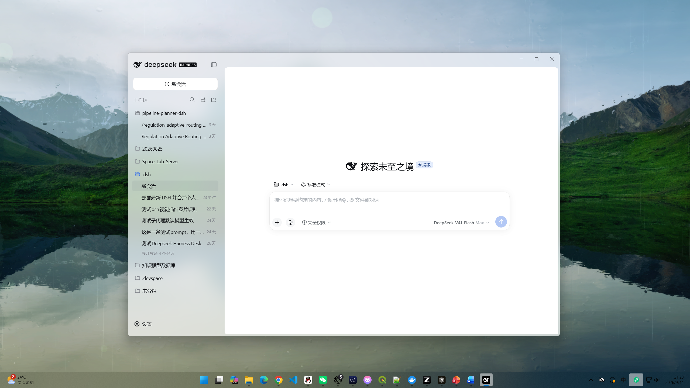

# DeepSeek Harness Desktop

This is a **personal Windows desktop build**, not an official DeepSeek installer.

It uses the official Electron shell [`apps/desktop`](https://github.com/deepseek-ai/deepseek-harness/tree/master/apps/desktop). The release identity matches `@deepseek-ai/dsh`: **0.1.5-rc.2**. The old Tauri wrapper is gone, and the personal 0.2 / 0.3 / 0.4 version line is not continued.

[中文](README.md)



## Download

The installer is on the GitHub Release: **[v0.1.5-rc.2](https://github.com/fsw2781890522/dsh-desktop/releases/tag/v0.1.5-rc.2)**

- File: `deepseek-harness-0.1.5-rc.2-win-x64.exe` (Windows x64 NSIS)
- Not EV-signed; SmartScreen may warn about an unknown publisher
- User data stays in `~/.dsh`, shared with the CLI and older desktop builds

## What this build actually adds

On top of official Desktop source, this snapshot keeps the personal chrome and settings. It does not wrap `dsh web` in Tauri:

- **Window:** no title-bar name or icon; native Windows min / max / close; white glyphs in dark UI, gray in light UI; the caption strip is draggable
- **Embracing glass:** title bar and sidebar share one plate; the session area floats as an opaque rounded card (smaller radius on the bottom-right); maximizing squares the window corners and keeps the card radii
- **Icon:** official white whale on a black rounded square
- **Settings:** sidebar tint, proxy port (feeds the official `dsh-http-proxy` policy; it does not retry direct-first), separate Agent and Subagent default models
- **Development:** still uses `~/.dsh`, not `.desktop-build/development/home`

Capabilities already in official 0.1.5 are not reimplemented: turn navigation, process collapse, the right sidebar, multimodal input, and `read_image`. This build does not ship `dsh-better-sidebar`, ModLens, or Anchored Standard.

## Run from source (optional)

`main` is the official 0.1.5-rc.2 tree plus the desktop changes above. Needs Node.js 22+ and pnpm:

```powershell
pnpm install
pnpm run start:desktop
```

Unsigned Windows installer:

```powershell
$env:DSH_DESKTOP_APP_ID = 'ai.deepseek.harness'
$env:DSH_DESKTOP_ALLOW_UNSIGNED = '1'
$env:DSH_DESKTOP_AUTO_UPDATE_ENV = 'test'
$env:DOWNLOAD_TEST_ORIGIN = 'https://github.com'
pnpm --filter @deepseek-ai/dsh-desktop run package:win:x64
```

Output: `apps/desktop/.desktop-build/targets/win-x64/artifacts/`.

## Branches

Only **`main`** (default, current desktop snapshot) and **`dev`**. Do not open Dependabot or feature branches on this repository.
